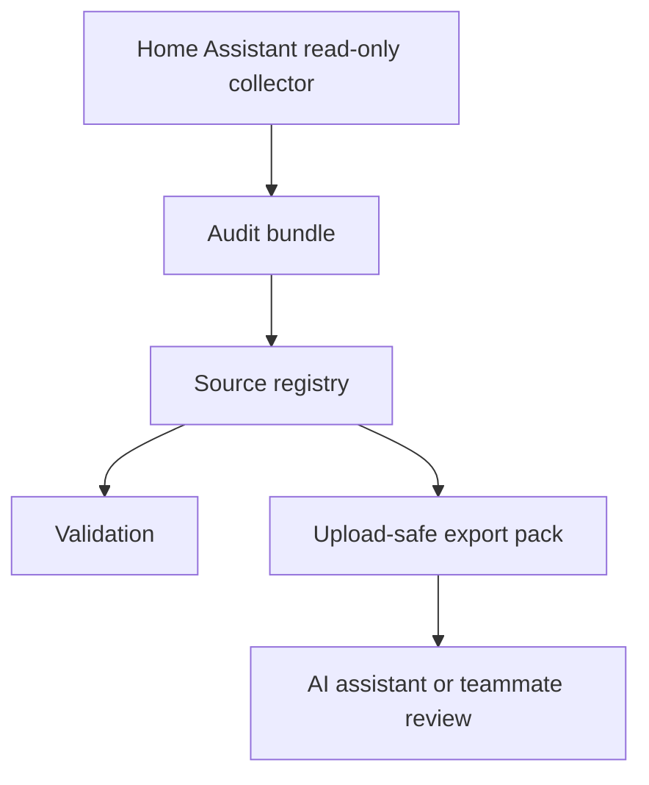

# Architecture

The toolkit is built around generated evidence bundles:

This public repo starts at the bundle layer. It does not collect from or mutate
Home Assistant directly.

## Modules

- `registry.py`: creates a source registry from a bundle.
- `exporter.py`: copies only upload-safe files into a flat export directory.
- `validator.py`: checks required files, JSON/CSV record counts, export
  consistency, and possible secrets.
- `secret_scan.py`: shared secret-pattern scanning.
- `cli.py`: command-line entrypoint.

## Source Hierarchy

- `raw/`: direct evidence; private by default.
- `normalized/`: structured working data; useful for analysis.
- `reports/`: human-readable summaries; useful for orientation.
- `index/`: generated bundle metadata.
- safe export: current-only assistant upload surface.

